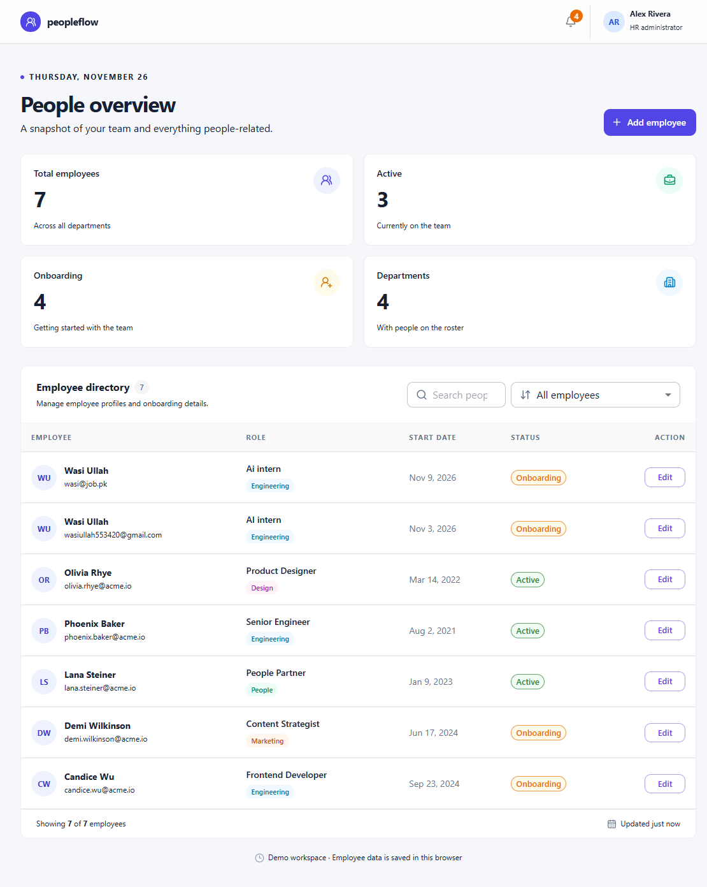

# Peopleflow

Peopleflow is a React, Vite, and TypeScript demo for employee onboarding, employee
profiles, and leave requests. The interface uses Material UI, and forms use React
Hook Form with built-in and custom validation.



## What is included

- **Employee dashboard:** Search and filter the employee directory, view team
  statistics, and edit employee profiles.
- **Employee onboarding:** A three-step form with required-field checks, custom
  phone validation, async duplicate-email validation, and repeatable work-history
  fields.
- **Employee status management:** Change an employee between `Active` and
  `Onboarding` from their edit form. Dashboard totals and onboarding notifications
  update with the saved status.
- **Leave requests:** Submit requests with custom date, overlap, and reason
  validation. Review pending requests and approve or reject them.
- **Workspace settings:** Update the demo workspace name and profile details.
- **Reusable UI:** Shared text and select fields, dashboard cards and rows, dialogs,
  and a shared Material UI theme.

## Project structure

```text
src/
├── App.tsx                       # App-level state and feature composition
├── main.tsx                      # React entry point and theme provider
├── theme.ts                      # Shared Material UI theme
├── index.css                     # Global styles
├── assets/                       # Images and starter assets
├── components/
│   ├── AppShell.tsx              # Header, navigation, notifications, settings
│   ├── EmployeeDashboard.tsx     # Dashboard, search, filters, directory
│   ├── EmployeeForm.tsx          # Employee onboarding and edit forms
│   ├── EmployeeStatCard.tsx      # Reusable dashboard statistic card
│   ├── EmployeeTableRow.tsx      # Employee directory row
│   ├── LeaveRequestForm.tsx      # Leave request form and validation
│   ├── LeaveRequestsDialog.tsx   # Approve/reject leave requests
│   ├── HelpDialog.tsx            # Help and support
│   ├── ProfileSettingsDialog.tsx # Profile settings
│   ├── WorkspaceSettingsDialog.tsx # Workspace settings
│   ├── TextField.tsx             # Shared React Hook Form text field
│   ├── SelectField.tsx           # Shared controlled select field
├── data/
│   ├── employeeService.ts        # Demo employee data and save/email checks
│   ├── leaveRequestService.ts    # Local leave request persistence and decisions
│   └── settingsService.ts        # Local profile and workspace settings
└── types/
    ├── employee.ts               # Employee and form data types
    └── leaveRequest.ts           # Leave request and status types

tailwind-backup/                  # Preserved Tailwind version of the app
```

`App.tsx` coordinates the top-level employee and dialog state. The dashboard owns
its search and filter state, while form logic and reusable interface elements live
in `components/`. Data access and demo persistence are kept in `data/`, with shared
domain types in `types/`.

## Data and validation notes

This is a front-end demo with no backend. Employee records, leave requests, profile
settings, and workspace settings are stored in the browser's local storage, so they
are specific to that browser. Employee email checks and saves simulate server
requests; replace the service functions in `src/data/` with API calls when adding a
backend.

React Hook Form powers employee and leave forms. Validation includes field rules,
custom cross-field date checks, pending/approved leave overlap checks, asynchronous
duplicate-email checks, and inline error messages. Formik is not used.

## Getting started

```sh
npm install
npm run dev
```

## Available scripts

```sh
npm run build  # Type-check and create a production build
npm run lint   # Lint the source
```
