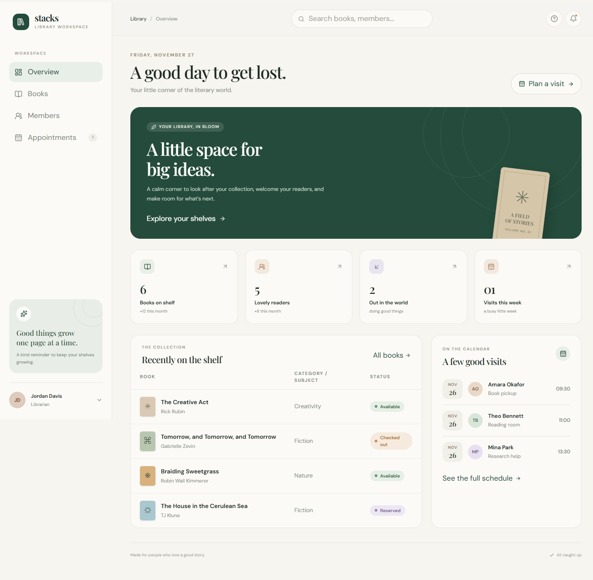

# Stacks — Library Workspace

Stacks is a library-management app built with React, TypeScript, and Vite. It brings books, readers, and library appointments together in a calm, responsive workspace.
---

---
## Features

- **Overview dashboard** with collection, member, loan, and appointment summaries.
- **Books** with a local shelf and book search powered by the [Open Library Search API](https://openlibrary.org/developers/api).
- **Members** with optional email, Active/Inactive visitor status, and individual book histories. Record loans and mark books as returned.
- **Appointments** with a form for adding visits, search, and Upcoming/Past tabs.
- **Persistent workspace data** stored in the browser with `localStorage`.
- **Keyboard shortcuts** for navigation, search, and opening forms. Use the help icon in the header to view the shortcut list.
- **Responsive interface** styled with Tailwind CSS and Lucide icons.

## Getting started

### Requirements

- Node.js and npm

### Install and run

```bash
npm install
npm run dev
```

Open the local URL printed by Vite in your terminal.

### Available scripts

| Command | Description |
| --- | --- |
| `npm run dev` | Start the local development server |
| `npm run build` | Type-check the project and create a production build |
| `npm run preview` | Preview the production build locally |
| `npm run lint` | Run Oxlint |

## Routes

| Route | Section |
| --- | --- |
| `/` | Overview |
| `/books` | Books |
| `/members` | Members |
| `/appointments` | Appointments |

## Learning concepts

This project demonstrates reusable hooks, TypeScript generics, composable UI, and separation of concerns:

- **`useFetch<T>`** — fetches typed JSON data, tracks loading and error state, and cancels an in-flight request when needed.
- **`useDebounce<T>`** — delays search updates to avoid doing work on every keystroke.
- **`useLocalStorage<T>`** — keeps React state synchronized with browser storage so workspace changes survive a refresh.
- **`DataTable<T>`** — renders different typed records using reusable column definitions.
- **Compound components** — `Tabs.Root` / `Tabs.Trigger` / `Tabs.Content` and `Modal.Root` / `Modal.Content` compose flexible interfaces.
- **Separation of concerns** — hooks, shared components, and data types live separately from the main application workspace.

## Project structure

```text
public/
  library.json             # Initial books, members, and appointments
src/
  components/
    DataTable.tsx          # Generic table
    Modal.tsx              # Compound modal
    Tabs.tsx               # Compound tabs
  hooks/
    useDebounce.ts         # Debounced values
    useFetch.ts            # Typed fetch state
    useLocalStorage.ts     # Persistent browser state
  App.tsx                  # Routes and workspace sections
  types.ts                 # Shared TypeScript models
  main.tsx                 # Application entry point
```

## Data and external services

- The initial sample workspace is loaded from `public/library.json`.
- Books searched in the catalog come from Open Library. Catalog search requires an internet connection.
- Changes to the local shelf, members, book histories, and appointments are stored in this browser's `localStorage`; they are not synchronized to a server or shared across devices.

## Keyboard shortcuts

| Shortcut | Action |
| --- | --- |
| `Ctrl` / `⌘` + `K` or `/` | Focus search |
| `N` | Open the add-record form |
| `1`–`4` | Navigate between sections |
| `Esc` | Close the current dialog |

