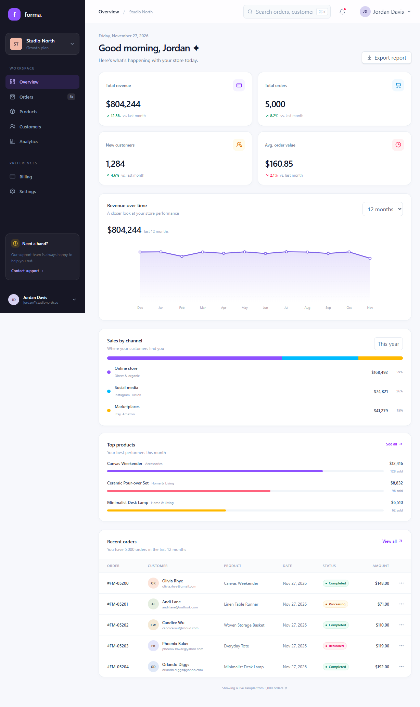

# Forma Sales Dashboard

A responsive sales analytics dashboard built with React, TypeScript, Vite, and Tailwind CSS. It includes a generated dataset of 5,000 orders and examples of React rendering and performance techniques.
---



---
> **Demo data:** This project does not connect to a real store or backend. Orders, customer details, products, and most comparison figures are sample data.

## Features

- **Overview dashboard:** revenue, orders, customers, average order value, revenue chart, sales channels, top products, and recent orders.
- **Date-aware revenue chart:** choose 7 days, 30 days, or 12 months. The chart and total calculate from orders in that time range.
- **Orders:** search by order ID, customer, email, or product; filter by status; paginate through results; export the filtered results as CSV.
- **Global search:** search orders, customers, and products from the top bar. Selecting a result opens matching orders. Use `Ctrl+K` or `⌘K` on desktop, or the search button on mobile.
- **Products and customers:** sample performance summaries and customer activity.
- **Responsive navigation:** desktop sidebar and mobile navigation drawer.
- **Loading and error states:** lazy-loaded routes show a loading fallback; render errors show a recovery screen.

## Requirements

- Node.js `^20.19.0` or `>=22.12.0` (Vite 8 requirement)
- npm

## Getting started

From the project directory:

```bash
npm install
npm run dev
```

Open the local URL printed by Vite, usually `http://localhost:5173`.

## Scripts

| Command | Description |
| --- | --- |
| `npm run dev` | Start the Vite development server with hot module replacement. |
| `npm run build` | Run the TypeScript project build, then create the production bundle in `dist/`. |
| `npm run preview` | Serve the production build locally after running `npm run build`. |
| `npm run lint` | Run Oxlint over the project. |

## Routes

| Path | Page |
| --- | --- |
| `/` | Sales overview |
| `/orders` | Searchable, filterable, paginated order list |
| `/products` | Product performance summary |
| `/customers` | Customer activity summary |
| `/analytics` | Analytics route (currently reuses the product insights view) |

Unknown routes redirect to `/`.

## Project structure

```text
src/
├── App.tsx                         # Error boundary, lazy pages, and route table
├── main.tsx                        # React root and global CSS
├── index.css                       # Tailwind import and global base styles
├── data/
│   └── orders.ts                   # Order types and generated sample data
├── components/
│   ├── dashboard/                  # Metrics, chart, breakdowns, and order table
│   ├── layout/                     # Sidebar, top bar, and shared app layout
│   ├── search/                     # Global search and result list
│   └── ui/                         # Compound Card and loading state
└── pages/
    ├── DashboardPage.tsx
    ├── OrdersPage.tsx
    ├── InsightsPage.tsx
    └── CustomersPage.tsx
```

### Main implementation files

- `src/App.tsx` defines routes, lazy imports, Suspense, and the app-level error boundary.
- `src/data/orders.ts` defines the `Order` and `OrderStatus` types and creates the 5,000 in-memory demo orders.
- `src/components/dashboard/RevenueChart.tsx` groups order revenue into the selected time range.
- `src/components/search/GlobalSearch.tsx` provides desktop and mobile global search.
- `src/pages/OrdersPage.tsx` handles order search, status filtering, URL-backed pagination, and CSV export.
- `src/components/ui/Card.tsx` demonstrates compound composition with `Card.Header`, `Card.Title`, `Card.Description`, and `Card.Content`.

## Demo data behavior

The order records are generated in memory when the data module loads. Their dates span from the beginning of the current 12-month chart window through the current date. The revenue chart aggregates those orders for the selected range; dashboard revenue and average order value are calculated from the generated orders.

The dashboard's displayed comparison percentages, customer totals, sales-channel breakdown, and top-product summary are illustrative values. They are not calculated from an external API. Refreshing the app regenerates the date window; it does not fetch or persist actual sales.

## React performance topics

This project is structured to demonstrate common performance concepts. These techniques prevent avoidable work in relevant cases; they do not stop React from rendering when a component's own state changes.

### Why components re-render

A component can render again when its state changes, its props change, or its parent renders. Examples:

- The chart's selected time range is state owned by `RevenueChart`.
- The order search and filters update the order page's URL state.
- The mobile navigation drawer is controlled by state in `AppLayout`.

Rendering again does not always mean the browser will repaint every element. React compares the output and commits the necessary updates.

### `React.memo`

`MetricCard`, `OrdersTable`, `StatusBadge`, and the compound Card components are memoized. When a parent renders again with shallowly equal props, React can reuse their previous render result. A memoized component still renders when its own state or consumed context changes.

### `useMemo`

- `OrdersPage` memoizes the filtered and visible orders.
- `RevenueChart` memoizes its time-range data, total, and SVG coordinates.
- `DashboardPage` memoizes the recent-order selection.

### `useCallback`

`OrdersPage` memoizes search, filter, pagination, and CSV export handlers. Stable function references are useful when passed to memoized children or used as dependencies.

### Lazy loading, code splitting, and Suspense

The route pages are loaded with `React.lazy` in `App.tsx`. Vite emits separate route chunks for production instead of requiring every page in the initial JavaScript bundle. A shared `Suspense` boundary displays `LoadingScreen` while a route chunk loads.

### Error boundaries

`AppErrorBoundary` catches errors during rendering in its descendant tree and shows a retry screen. React error boundaries do not catch errors from event handlers, most asynchronous callbacks, or server-side rendering.

### Avoiding unnecessary work

- The order table displays ten rows per page rather than rendering all 5,000 at once.
- Filtering and chart calculations are memoized based on their inputs.
- Shared layout, table, and metric UI are split into focused components.
- The global search index is derived once from the sample orders, and displayed results are limited.

## Using React DevTools Profiler

React DevTools Profiler is a browser developer tool, not an additional app route or package in this project.

1. Install the React Developer Tools browser extension.
2. Open the dashboard and select the **Profiler** tab in browser developer tools.
3. Start recording, then change the chart range or type into search.
4. Stop recording and inspect which components rendered, how often, and how long each commit took.
5. Compare the results before and after a focused optimization. Avoid adding memoization unless profiling shows that the work is worth reducing.

## Styling and libraries

- **Tailwind CSS 4** is integrated through `@tailwindcss/vite`; global styles and the Tailwind import are in `src/index.css`.
- **React Router** handles client-side navigation.
- **Lucide React** supplies the interface icons.
- **Oxlint** runs the configured lint checks.

