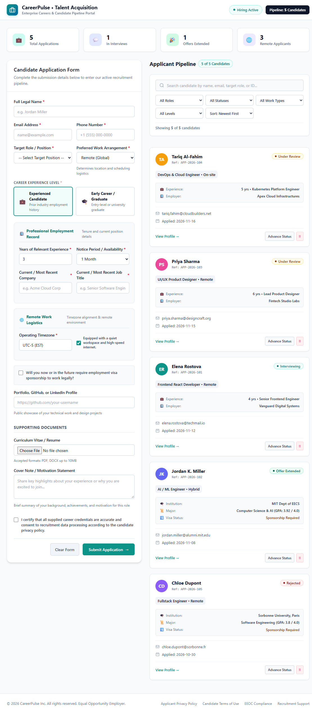

# CareerPulse &bull; Job Application Portal (React Day 4)



A job application management portal built with **React 19**, **TypeScript**, **CSS Modules**, and **Tailwind CSS**.

This project implements a **Job Application Form with Dynamic Conditional Fields**, structured following the same architecture and learning objectives as Day 4:

---

## ⚡ Conditional Fields Implementation

The form dynamically adapts its inputs and validation rules based on user selections:

### 1. Experience Level Conditional Branch
- **Experienced Professional** (`experienceType === 'experienced'`):
  - Displays: **Years of Experience**, **Notice Period**, **Current / Most Recent Company**, **Current Job Title**.
  - Dynamically enforces validation requiring company and job title.
- **Fresh Graduate / Entry Level** (`experienceType === 'fresh-grad'`):
  - Displays: **University / College**, **Degree & Major**, **Graduation Year**, **Cumulative GPA**, **Capstone Project URL**.
  - Dynamically enforces validation requiring university and major.

### 2. Work Arrangement Conditional Logistics
- **Remote** (`workArrangement === 'Remote'`):
  - Reveals: **Operating Timezone** input, **Dedicated Home Office** verification checkbox.
- **Hybrid / On-site** (`workArrangement !== 'Remote'`):
  - Reveals: **Willing to Relocate** confirmation checkbox, **Relocation Timeframe** dropdown.

### 3. Visa Sponsorship Conditional Section
- **Requires Sponsorship Checkbox**:
  - When checked: Reveals **Current Visa Status** and **Visa Expiration Date** inputs with required date validation.
  - When unchecked: Completely bypasses visa fields and validation.

---

## 🎯 Learning Objectives Covered

1. **Conditional Fields & Dynamic Rendering**
   - Implemented in [JobApplicationForm.tsx](file:///F:/React/Day-4/Job%20Application/src/components/form/JobApplicationForm.tsx) using logical `&&` branches and dynamic validation.
2. **Controlled Components**
   - All standard and conditional form fields are tied to React state (`formData` + `onChange`).
3. **Uncontrolled Components (useRef)**
   - **Resume File Upload**: `<input type="file" ref={resumeInputRef} />` (uncontrolled by HTML standard).
   - **Executive Cover Note**: `<textarea ref={coverLetterRef} />` reading value on submit without triggering re-renders during typing.
4. **Rendering Lists**
   - [ApplicationList.tsx](file:///F:/React/Day-4/Job%20Application/src/components/list/ApplicationList.tsx) renders submitted candidate cards via `.map()`.
5. **Keys and Why They Matter**
   - Unique application ID (`key={application.id}`) preserves state and prevents reconciliation bugs across sorting and filtering.
6. **Rendering and Reconciliation Basics**
   - Clicking "Advance Pipeline" or "Delete" triggers targeted virtual DOM diffing and updates only the affected card.
7. **Form Handling & Submission**
   - `e.preventDefault()`, conditional validation, form reset (state + refs), focus management, and success alert banner.
8. **Lifting State Up**
   - Master applications state, active filters, and modal view are held in [App.tsx](file:///F:/React/Day-4/Job%20Application/src/App.tsx) and shared across sibling components.
9. **Search & Filter on a List**
   - Multi-field search (Name, Email, Role, ID), dropdown filters (Position, Status, Arrangement, Experience), and multi-criteria sorting computed via `useMemo`.
10. **Component Composition & CSS Modules**
    - Composable compound components: `<Card>`, `<Card.Header>`, `<Card.Body>`, `<FormField>`, `<Badge>`, and `<Modal>`.
    - Every component has an isolated `*.module.css` file for scoped styling.

---

## 📂 Project Structure

```
src/
├── types/
│   └── jobApplication.ts               # TypeScript types and conditional models
├── data/
│   └── initialApplications.ts          # Sample candidate pipeline data
├── components/
│   ├── ui/
│   │   ├── Card.tsx & Card.module.css
│   │   ├── Badge.tsx & Badge.module.css
│   │   ├── FormField.tsx & FormField.module.css
│   │   └── Modal.tsx & Modal.module.css
│   ├── layout/
│   │   ├── Header.tsx & Header.module.css
│   │   └── Footer.tsx & Footer.module.css
│   ├── stats/
│   │   ├── ApplicationStats.tsx & ApplicationStats.module.css
│   │   └── ApplicationStats.module.css
│   ├── form/
│   │   ├── JobApplicationForm.tsx & JobApplicationForm.module.css
│   ├── list/
│   │   ├── ApplicationFilters.tsx & ApplicationFilters.module.css
│   │   ├── ApplicationCard.tsx & ApplicationCard.module.css
│   │   ├── ApplicationList.tsx & ApplicationList.module.css
│   │   └── ApplicationDetailModal.tsx & ApplicationDetailModal.module.css
│   └── education/
│       └── ConceptGuide.tsx & ConceptGuide.module.css
├── App.tsx & App.module.css             # Lifted state container
├── index.css                            # Tailwind CSS + custom design tokens
└── main.tsx                             # React 19 root
```

---

## 🚀 Running the Project

```bash
cd "F:\React\Day-4\Job Application"
npm run dev
```
