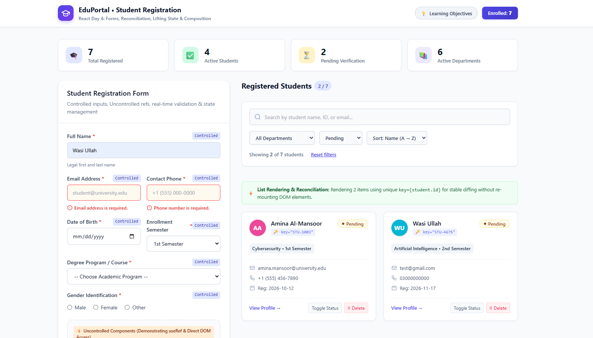

# Student Registration Application (React Day 4)



A complete, production-ready Student Registration Portal built with **React 19**, **TypeScript**, **CSS Modules**, and **Tailwind CSS**.

This project implements and demonstrates all **Day 4 Learning Objectives**:

---

## 🎯 Learning Objectives Covered

1. **Rendering Lists**
   - Renders arrays of student records dynamically using JavaScript `.map()` returning JSX elements.
   - Handled inside [StudentList.tsx](file:///F:/React/Day-4/Student%20Registration/src/components/list/StudentList.tsx).

2. **Keys and Why They Matter**
   - Uses unique, stable keys (`key={student.id}`, e.g. `STU-1001`) instead of array indexes.
   - Prevents state retention bugs across re-orders, inserts, and deletions.
   - Visual key badges are displayed directly on the UI for learning reference.

3. **Rendering & Reconciliation Basics**
   - Explains and demonstrates Virtual DOM reconciliation.
   - Toggling student status (`Active` &harr; `Pending` &harr; `Inactive`) or deleting a student updates only the affected card in the DOM.

4. **Controlled Components**
   - Primary form fields (Full Name, Email, Phone, Date of Birth, Gender, Course, Semester, Terms checkbox) are governed by React state (`formData` + `onChange`).
   - React state serves as the single source of truth.

5. **Uncontrolled Components**
   - Demonstrates inputs managed directly by the DOM using React's `useRef()` hook.
   - **Student ID Card File Upload**: `<input type="file" ref={fileInputRef} />` (file inputs must always be uncontrolled).
   - **Counselor Notes / Remarks**: `<textarea ref={notesRef} defaultValue="" />` read on submission without triggering re-renders during typing.

6. **Form Handling and Submission**
   - Intercepts default form submission via `e.preventDefault()`.
   - Synchronous validation across all fields before dispatching state updates.
   - Automatic form reset (controlled state + ref DOM values) and focus management.

7. **Input Validation and Error Messages**
   - Live validation on blur and submit with visual indicators, red borders, and ARIA attributes (`aria-invalid`, `role="alert"`).
   - Rules: Full Name (min 3 chars, alpha), Email (regex), Phone (min 10 digits), DOB (min 15 years old), Course selection, and Terms agreement.

8. **Lifting State Up**
   - Master student state and filter state are lifted to the parent [App.tsx](file:///F:/React/Day-4/Student%20Registration/src/App.tsx).
   - Child components receive state and update handlers:
     - `StudentForm`: receives `onRegisterStudent`
     - `StudentStats`: receives `students`
     - `StudentFilters`: receives filter states and change handlers
     - `StudentList`: receives filtered students, delete handler, and toggle status handler

9. **Search and Filter on a List**
   - Real-time search by Student Name, Email, Phone, or ID.
   - Filtering by Academic Department / Course and Enrollment Status.
   - Sorting by Newest, Oldest, Name (A-Z), and Name (Z-A).
   - Implemented as efficient derived state using `useMemo`.

10. **Tailwind CSS & CSS Modules**
    - **Tailwind CSS**: Configured with PostCSS and Autoprefixer for rapid utility styles and base typography.
    - **CSS Modules**: Every component has a dedicated `*.module.css` file providing scoped styles and preventing style collisions.

11. **Component Composition**
    - Compound and composed components using `children` and slots:
      - `<Card>` (`Card.Header`, `Card.Body`, `Card.Footer`)
      - `<FormField>` (encapsulating label, tag, input slot, helper text, and error message)
      - `<Badge>` (flexible status indicators)
      - `<Modal>` (reusable dialog for dossiers and concept reference)

---

## 🚀 Getting Started

### 1. Install dependencies
```bash
npm install
```

### 2. Start development server
```bash
npm run dev
```

### 3. Build for production
```bash
npx vite build
```

---

## 📂 Project Architecture

```
src/
├── types/
│   └── student.ts               # Student, Form, and Filter TypeScript interfaces
├── data/
│   └── initialStudents.ts       # Sample student records & course catalogs
├── components/
│   ├── ui/
│   │   ├── Card.tsx             # Composed Card component
│   │   ├── Card.module.css
│   │   ├── Badge.tsx            # Variant Badges
│   │   ├── Badge.module.css
│   │   ├── FormField.tsx        # Composed FormField wrapper
│   │   ├── FormField.module.css
│   │   ├── Modal.tsx            # Accessible Dialog Modal
│   │   └── Modal.module.css
│   ├── layout/
│   │   ├── Header.tsx           # Sticky Portal Header
│   │   ├── Header.module.css
│   │   ├── Footer.tsx           # Footer with concepts
│   │   └── Footer.module.css
│   ├── stats/
│   │   ├── StudentStats.tsx     # Derived metrics cards
│   │   └── StudentStats.module.css
│   ├── form/
│   │   ├── StudentForm.tsx      # Controlled + Uncontrolled form
│   │   └── StudentForm.module.css
│   ├── list/
│   │   ├── StudentFilters.tsx   # Search, filter, and sort controls
│   │   ├── StudentFilters.module.css
│   │   ├── StudentCard.tsx      # Individual student card
│   │   ├── StudentCard.module.css
│   │   ├── StudentList.tsx      # List rendering & key demo
│   │   ├── StudentList.module.css
│   │   ├── StudentDetailModal.tsx # Full dossier viewer
│   │   └── StudentDetailModal.module.css
│   └── education/
│       ├── ConceptGuide.tsx     # Interactive Day 4 concepts accordion
│       └── ConceptGuide.module.css
├── App.tsx                      # Root component with lifted state
├── App.module.css
├── index.css                    # Tailwind directives & CSS custom properties
└── main.tsx                     # React 19 entry point
```
