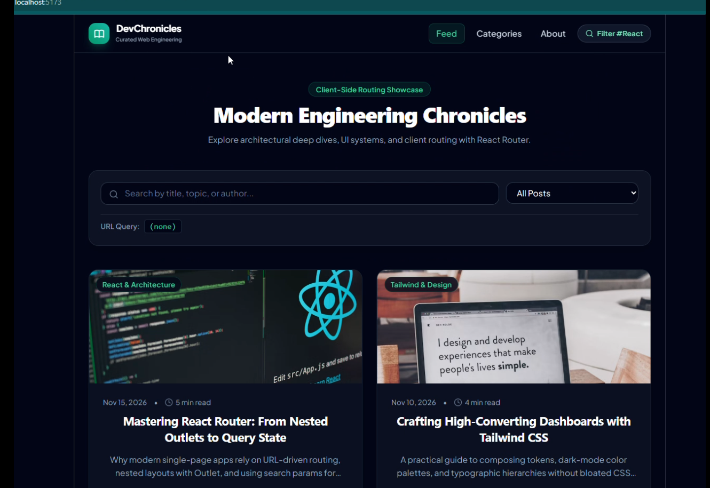

# DevChronicles - Blog Reader (Day 6 - React Router Lab)

A fast, minimalist technical blog reader built with **React**, **React Router v7**, and **Tailwind CSS**.

---



---

## ?? Folder Structure

```text
Blog Reader/
+-- index.html                   # HTML entry point with Tailwind CDN and typography
+-- package.json                 # Dependencies (React 19, React Router v7)
+-- vite.config.js               # Vite configuration
+-- README.md                    # Project documentation
+-- src/
    +-- main.jsx                 # App root wrapped inside <BrowserRouter>
    +-- App.jsx                  # Route definitions (Routes, Route, nested Outlet)
    +-- index.css                # Global styling
    ¦
    +-- components/
    ¦   +-- BlogLayout.jsx       # Layout shell with Header, Footer, and <Outlet />
    ¦   +-- Header.jsx           # Top navbar using <NavLink> with active styling
    ¦   +-- Footer.jsx           # Footer with routing navigation links
    ¦   +-- Icons.jsx            # Lightweight SVG icon collection
    ¦
    +-- data/
    ¦   +-- blogData.js          # Articles, author info, categories, and tags
    ¦
    +-- pages/
        +-- HomeFeed.jsx         # Post feed with live filters via useSearchParams (?q=...&category=...)
        +-- PostDetail.jsx       # Dynamic post view via useParams (:slug) and useNavigate(-1)
        +-- CategoriesPage.jsx   # Categories catalog & category post filter (/categories/:categorySlug)
        +-- AboutPage.jsx        # Project overview & architectural notes
        +-- NotFound.jsx         # 404 wildcard route (<Route path="*">)
```

---

## ?? Routing Objectives Implemented

| Topic | File | How It Is Used |
| :--- | :--- | :--- |
| **BrowserRouter & Routes** | `src/main.jsx`, `src/App.jsx` | Full client-side navigation without reloads |
| **NavLink & Link** | `src/components/Header.jsx` | `NavLink` with `isActive` tab highlights, `Link` for cards |
| **Nested Routes & Outlet** | `src/components/BlogLayout.jsx` | Persistent header/footer wrapping dynamic child pages |
| **useParams** | `src/pages/PostDetail.jsx`, `CategoriesPage.jsx` | Dynamic slug lookup (`/posts/:slug`, `/categories/:categorySlug`) |
| **useSearchParams** | `src/pages/HomeFeed.jsx` | Query parameter filtering for title, category, and tags |
| **useNavigate** | `PostDetail.jsx`, `NotFound.jsx`, `Header.jsx` | Back navigation (`navigate(-1)`) & programmatic quick filters |
| **404 Not Found** | `src/pages/NotFound.jsx` | Catches unmatched URLs (`<Route path="*" />`) |

---

## ?? How to Run

```powershell
cd "F:\React\Day-6\Blog Reader"
npm run dev
```
Open **`http://localhost:5173`** in your browser.
