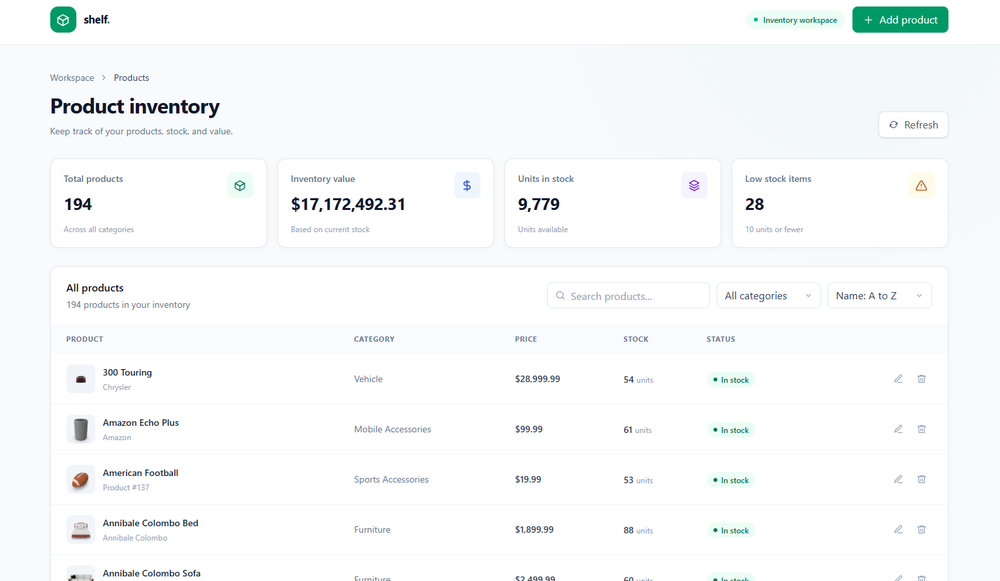

# Shelf — Product Inventory Dashboard

Shelf is a product inventory dashboard for viewing and managing a product catalog. It is built with React, Tailwind CSS, and CSS modules.



## Features

- View inventory totals, stock levels, low-stock items, and estimated inventory value.
- Search products by name, brand, category, or ID.
- Filter by category and sort by name, price, or stock level.
- Browse the catalog with pagination.
- Add, edit, update stock, and delete products.

## Getting started

From the project directory, install dependencies and start the development server:

```sh
npm install
npm run dev
```

Open the local URL printed by Vite in your terminal.

## Available scripts

| Command | Description |
| --- | --- |
| `npm run dev` | Start the development server |
| `npm run build` | Create a production build |
| `npm run preview` | Preview the production build locally |
| `npm run lint` | Run Oxlint |

## Data and persistence

The dashboard loads its initial product catalog from the [DummyJSON Products API](https://dummyjson.com/docs/products). DummyJSON simulates create, update, and delete requests; changes are not saved to a persistent database. Products added in the dashboard and edits to them are kept in the current page session only. Reloading the page restores the original API data.
