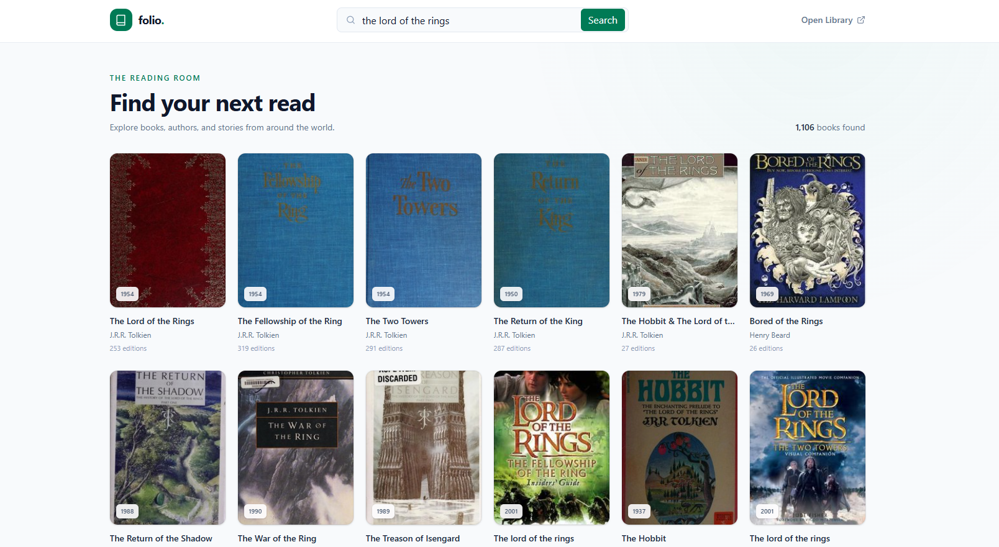

# Folio — Book discovery

A polished book discovery website built with React, Tailwind CSS.

Folio lets users search for books or authors, browse paginated results, open a book's
detail page, and view its cover, description, subjects, authors, and publication
information.



## How it works

1. Enter a title or author in the search field.
2. The React app sends the search to the public Open Library API.
3. Open Library returns matching books in JSON format.
4. React stores the results in state and displays them as book cards.
5. Selecting a book loads its work and author details, along with the cover image.

The main API flow is handled in `src/api/books.js`:

- `GET https://openlibrary.org/search.json` searches for books.
- `GET https://openlibrary.org/works/{workId}.json` retrieves book details.
- `GET https://openlibrary.org/authors/{authorId}.json` retrieves author names.
- `https://covers.openlibrary.org/b/id/{coverId}-{size}.jpg` provides cover images.

The website communicates directly with these public APIs using the browser's
`fetch()` function. The app cancels outdated requests and handles loading, error,
empty, pagination, and image states.

## Features

- Search books and authors
- Paginated search results
- Detailed book pages
- Book cover images
- Loading skeletons and error handling
- Browser back and forward navigation
- Responsive design for desktop and mobile

## Tech stack

- React 19
- Vite
- Tailwind CSS
- CSS Modules
- Open Library REST API

## Run locally

```sh
npm install
npm run dev
```

## API

Uses the free [Open Library API](https://openlibrary.org/developers/api) and cover service. No API key is required.

## Available scripts

- `npm run dev` — start the development server
- `npm run build` — create a production build
- `npm run lint` — run Oxlint
- `npm run preview` — preview the production build
