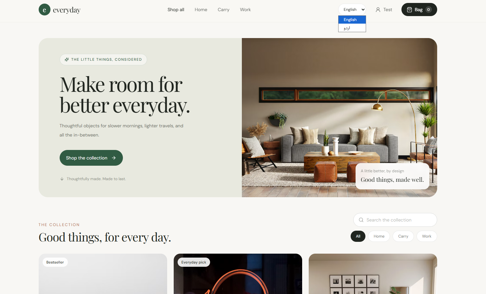

# Shoping Cart Application
---
A responsive React storefront with a persistent shopping bag, demo sign-in, and checkout flow.
---



## Run locally

```bash
npm install
npm run dev
```

Run checks with `npm run lint` and `npm test`. Create a production build with `npm run build`.

## Features

- Browse products and filter by category.
- Search products by name, category, or description.
- Switch between English and Urdu; Urdu uses right-to-left layout and language choice is saved locally.
- Add products to the shared shopping bag, update quantities, and remove items.
- Bag contents are saved in browser local storage and remain available across pages and reloads.
- Demo sign-in is stored locally; checkout collects shipping details and completes without processing payment.
- Responsive layouts for mobile and desktop.

## App structure

- `src/context/CartContext.jsx` provides the cart reducer, actions, derived totals, persistence, and `useCart`.
- `src/context/LanguageProvider.jsx` shares the current locale, translation helpers, and direction through `useLanguage`.
- `src/context/translations.js` holds English and Urdu UI strings and translated product content.
- `src/components/` contains reusable composed UI such as the header, product card, and cart drawer.
- `src/pages/` contains the storefront, sign-in, and checkout screens.
- `src/data/products.js` contains the demo catalog.
- `src/context/cartReducer.test.js` tests cart state transitions.

## Developer commands

- `npm run dev` starts the local development server.
- `npm run lint` checks JavaScript, JSX, and React hook usage.
- `npm test` runs the reducer tests once.
- `npm run build` creates the production bundle in `dist/`.

Add or update localized copy in both language entries in `src/context/translations.js`. Use `useLanguage()` in components for translated labels, product content, and category names; the provider also updates the document language and text direction.

The shared cart context avoids passing cart state through every component. `useReducer` centralizes cart actions, while component-local state handles form and screen interactions. The demo sign-in and checkout are front-end only; no real user account or payment is created.
