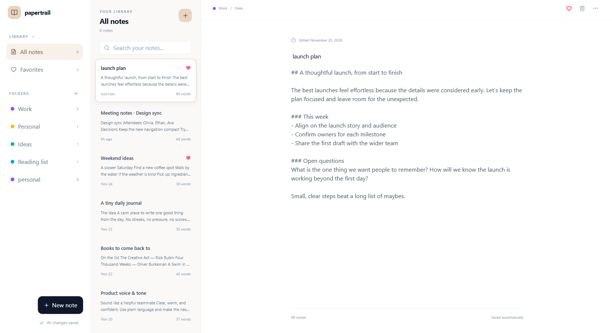

# Papertrail — Notes with Folders

A calm, responsive notes app built with React, TypeScript, Vite, and Tailwind CSS. Create and organize notes in folders, search notes, favorite important notes, and edit note content with automatic browser-local persistence. Folders can be created, renamed, and deleted; deleting a folder moves its notes to **All notes**.

---



---
## Run locally

```bash
npm install
npm run dev
```

Create a production build with `npm run build`, then preview it with `npm run preview`.

## Where the React state concepts are used

| Learning objective | Where it appears |
| --- | --- |
| Choosing where state should live | Shared folders, notes, current selection, and search live in `src/components/NotesProvider.tsx`; folder dialog draft text stays inside `FolderDialog`. |
| State colocation | Folder dialog text is local to the folder dialog; the provider owns workspace data shared between the sidebar, note list, and editor. |
| Lifting state up (advanced) | Active folder and selected note are shared through the provider so folder navigation, the note list, and editor stay in sync. |
| Avoiding duplicate state | A note stores one `folderId`; folder note lists and counts are filtered from the notes collection rather than stored separately. |
| Derived state | Folder counts, favorite count, filtered and sorted note lists, word counts, and note excerpts are calculated from current data. |
| Splitting contexts | `NotesStateContext` and `NotesActionsContext` separate workspace values from actions in `NotesProvider.tsx`. |
| State update batching | Creating a note updates workspace content and selection in one event; React batches those related state updates. |
| Resetting state with key | The folder dialog key changes for create vs. rename and between folders, resetting its draft input. |
| Optimistic updates and rollback | Note and folder changes update immediately, then save to local storage. If saving fails, the latest mutation rolls back and a notice is shown. |

## Project structure

- `src/components/` — all React components, provider, editor, note list, and folder navigation
- `src/notes.ts` — folder/note types, sample content, and persisted-data validation
- `src/style.css` — Tailwind import and global styles
- `vite.config.ts` — Vite integration for Tailwind CSS
