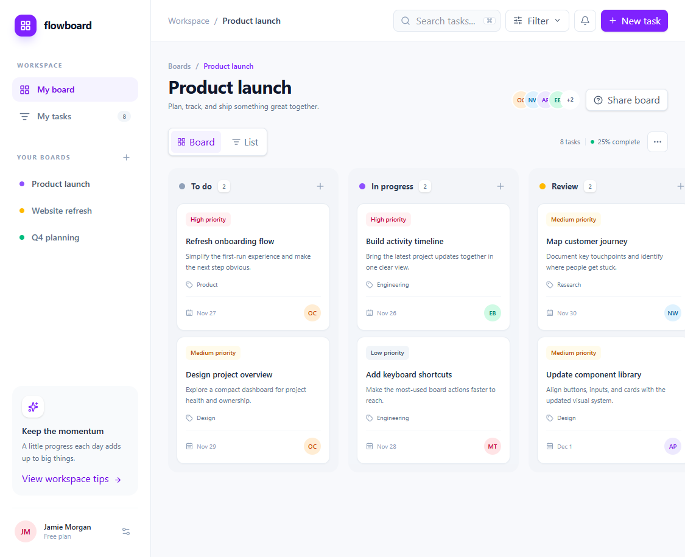

# Flowboard — Task Management Board

A responsive Kanban board built with React, TypeScript, Vite, and Tailwind CSS. Tasks can be created, edited, deleted, filtered, searched, and moved across **To do**, **In progress**, **Review**, and **Done**. Board changes persist in browser local storage.
---



---
## Run locally

```bash
npm install
npm run dev
```

Create a production build with `npm run build`, then preview it with `npm run preview`.

## Where the React state concepts are used

| Learning objective | Where it appears |
| --- | --- |
| Choosing where state should live | Shared board tasks, search, and priority filtering live in `src/components/BoardProvider.tsx`; the open dialog and its draft fields live in `BoardPage` and `TaskDialog`. |
| State colocation | The task form owns its temporary field values in `TaskDialog`; card menu visibility and drag feedback stay in `TaskCard`. |
| Lifting state up (advanced) | `dialogTask` is owned by `BoardPage`, so the page toolbar, columns, and cards can open the same create/edit dialog. |
| Avoiding duplicate state | Tasks store one `status` value. Column contents and counts are filtered from the task list rather than maintained separately. |
| Derived state | Visible tasks, per-column counts, completion percentage, and overdue styling are calculated from current task state. |
| Splitting contexts | `BoardStateContext` and `BoardActionsContext` in `src/components/BoardProvider.tsx` separate read-only board data from mutations and setters. |
| State update batching | Task creation/editing and the resulting dialog close happen in the same event; React batches these updates. |
| Resetting state with key | `TaskDialog` receives the task ID (or `new-task`) as its React `key`, resetting its draft fields when a different task is opened. |
| Optimistic updates and rollback | Mutations update the board immediately, then save to local storage. A failed save restores the last state when that update is still current and shows an error notice. |

## Project structure

- `src/components/` — all React components, including the app entry, board provider, board page, columns, task cards, and dialog
- `src/board.ts` — task/status types, starter tasks, and persisted-data validation
- `src/style.css` — Tailwind import and small global styles
- `vite.config.ts` — Vite integration for Tailwind CSS
